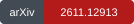
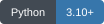
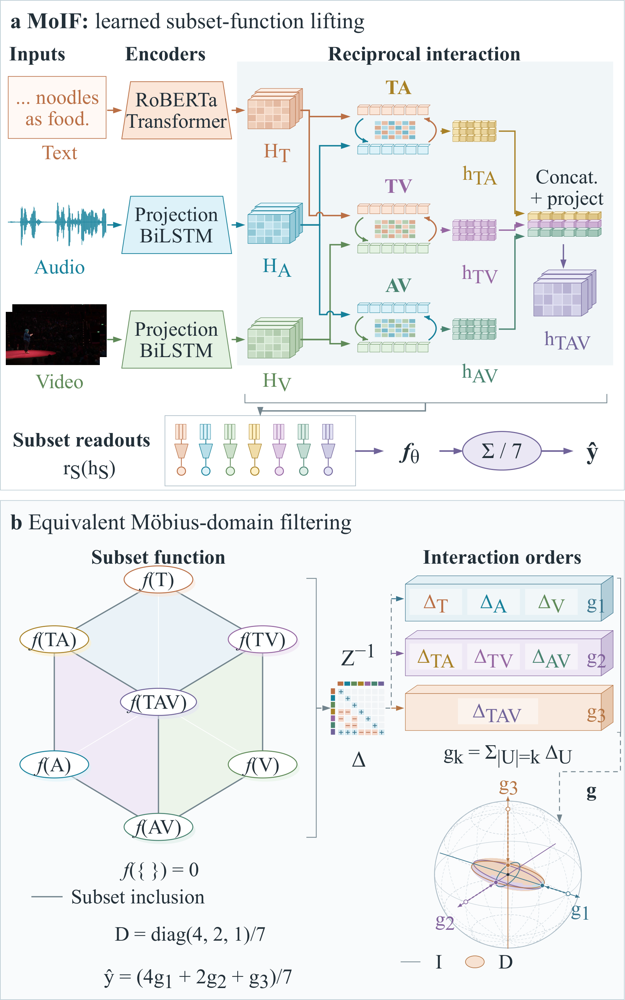

<div align="center">

<h1>MoIF</h1>

<h3>Möbius Interaction Filtering:<br>Order-Selective Spectral Regularization for Multimodal Humor Detection</h3>

<p><strong>Jiahao Qin and Yiwen Wang</strong></p>

<p>
  <a href="https://arxiv.org/abs/2611.12913"></a>
  <a href="LICENSE"></a>
  <a href="https://www.python.org/"></a>
  <a href="https://pytorch.org/"></a>
</p>

<p>
  <a href="https://arxiv.org/abs/2611.12913">Paper</a> &nbsp;|&nbsp;
  <a href="https://arxiv.org/pdf/2611.12913">PDF</a> &nbsp;|&nbsp;
  <a href="https://doi.org/10.48550/arXiv.2611.12913">DOI</a> &nbsp;|&nbsp;
  <a href="#citation">Citation</a>
</p>

</div>

---

**Official PyTorch implementation of MoIF.** MoIF learns a prediction function over modality subsets and regulates how different interaction orders enter the final decision. Its subset aggregate is exactly a Möbius-domain filter with responses **4/7, 2/7, and 1/7** for first-, second-, and third-order interactions.

[Overview](#overview) · [Installation](#installation) · [Data](#data) · [Training](#training) · [Evaluation](#evaluation) · [License](#license)

## Overview

<p align="center">
  <a href="assets/moif_architecture.pdf">
    
  </a>
</p>

**Figure 1. MoIF architecture and equivalent order-selective filtering.**

**(a)** Private encoders, reciprocal interactions, and trimodal composition learn seven subset predictions. **(b)** The same computation is expressed through Möbius increments and order-selective contraction.

[Open the full-resolution figure](assets/moif_architecture.png) · [Vector PDF](assets/moif_architecture.pdf)

- **Learn across subsets.** A shared model constructs unimodal, bimodal, and trimodal predictions from text, audio, and vision.
- **Filter by interaction order.** Uniform subset aggregation induces a geometric response in Möbius coordinates while keeping every interaction order active.
- **Inspect the prediction.** Evaluation exports all eligible subset scores; the spectral utility computes their interaction increments and order sums.

### What is included

| Component | Entry point |
| --- | --- |
| Model and subset prediction | [`moif/model.py`](moif/model.py) |
| Training and checkpoint selection | [`moif/train.py`](moif/train.py) |
| Evaluation and per-example predictions | [`moif/evaluate.py`](moif/evaluate.py) |
| Möbius decomposition | [`moif/spectral.py`](moif/spectral.py) |
| Paper configuration and input specification | [`configs/paper.json`](configs/paper.json) · [`docs/DATA_FORMAT.md`](docs/DATA_FORMAT.md) |
| Unit tests | [`tests/`](tests/) |

The release contains MoIF code, documentation, and the architecture figure.
Datasets, pretrained language-model weights, trained checkpoints, baseline
implementations, manuscript sources, and experiment outputs are not included.

## Installation

Use **Python 3.10 or later** and install a PyTorch build appropriate for your GPU.
Then run:

```bash
git clone https://github.com/D-ST-Sword/MoIF.git
cd MoIF
pip install -r requirements.txt
python -m unittest discover -s tests -v
```

Tests use small synthetic encoders and inputs, with no model downloads. Run all
commands below from the repository root.

<details>
<summary><strong>Reference environments</strong></summary>

| Hardware | PyTorch | CUDA |
| --- | --- | --- |
| NVIDIA V100 | 2.0.1 | 11.8 |
| NVIDIA RTX 5090 | 2.8.0 | 12.8 |

Both environments used Transformers 4.35.0 and NumPy 1.26.4. An RTX 5090 requires
a compatible recent PyTorch/CUDA build; the V100 environment is not interchangeable.
Unit tests are implementation checks, not benchmark experiments.

</details>

## Data

Obtain the datasets from their providers and respect their access terms:

| Dataset | Provider | Task |
| --- | --- | --- |
| UR-FUNNY | [UR-FUNNY repository](https://github.com/ROC-HCI/UR-FUNNY) | Humor detection |
| CMU-MOSI | [CMU Multimodal SDK](https://github.com/CMU-MultiComp-Lab/CMU-MultimodalSDK) | Sentiment prediction |
| CMU-MOSEI | [CMU Multimodal SDK](https://github.com/CMU-MultiComp-Lab/CMU-MultimodalSDK) | Sentiment prediction |

The loaders consume a **processed, unaligned feature pickle**, not raw media.
See [the input specification](docs/DATA_FORMAT.md) for required fields, feature
dimensions, masks, and splits. The repository does not redistribute or regenerate
the original audiovisual features; use the paper's feature protocol for reproduction.

`--pretrained` accepts `roberta-large` or a local Hugging Face snapshot containing
its weights and tokenizer. The text encoder and tokenizer must use the same
snapshot. Tokenization uses raw utterances with a maximum length of 64.

## Training

```bash
python -m moif.train \
  --dataset urfunny \
  --data /path/to/urfunny_unaligned_50.pkl \
  --seed 42 \
  --output runs/urfunny_seed42
```

Use `--dataset mosi` or `--dataset mosei` with the corresponding processed file.
The checkpoint with **minimum validation MAE** is selected; test evaluation
occurs after selection. Existing output directories are rejected to prevent
accidental run replacement.

| Dataset | Five training seeds |
| --- | --- |
| UR-FUNNY | 7, 22, 42, 93, 99 |
| CMU-MOSI | 22, 42, 93, 123, 456 |
| CMU-MOSEI | 22, 42, 93, 123, 456 |

<details>
<summary><strong>Training configuration</strong></summary>

| Setting | Value |
| --- | --- |
| Optimizer | AdamW |
| Batch size | 32 |
| Learning rate | 1e-5 |
| Weight decay | 1e-4 |
| Schedule | Cosine decay to 1e-7 over 40 epochs |
| Gradient clipping | 1.0 |
| Objective | Aggregate L1 + 0.1 × mean subset L1 |
| Early stopping | At least 20 epochs and 20 stale epochs |
| Mixed precision | CUDA autocast for the text backbone; float32 fusion |

The settings are also listed in [configs/paper.json](configs/paper.json).
Training uses the fixed settings in `moif/train.py`; the JSON is a configuration
record, not an additional override layer. `--smoke` performs two training batches
and validation only; it is not a result seed.

</details>

## Evaluation

```bash
python -m moif.evaluate \
  --dataset urfunny \
  --data /path/to/urfunny_unaligned_50.pkl \
  --checkpoint runs/urfunny_seed42/selected.pt \
  --output runs/urfunny_seed42_replay
```

Outputs include `metrics.json` and per-example `predictions.npz` with all eligible
subset scores. Use `--split train` or `--split valid` for the other splits.
Complete-input evaluation is the default. `--available audio vision` executes
only A, V, and AV, without calling the text encoder.

<details>
<summary><strong>Metric conventions and checkpoint compatibility</strong></summary>

Classification metrics are stored as **fractions, not percentages**. UR-FUNNY uses
signed labels and a threshold of `>= 0`. For MOSI/MOSEI, the paper's binary metric
is `has0_ge_zero`: neutral samples are retained on the nonnegative side. The
evaluator additionally reports `has0_gt_zero`, `non0_gt_zero`, and Acc-3/5/7.

The released model preserves the original `core.*` checkpoint parameter names.
Legacy checkpoints may store `variant="fixed_gate"`; this is the same final
MoIF computation. Each attention pair retains frozen, unused `gate` tensors to
preserve checkpoint keys and initialization RNG. They are never evaluated and
are not a learned routing component. Legacy checkpoints with pickled metadata
may require `--trusted-checkpoint`; use this only with files you trust.

</details>

## Interaction coordinates

```bash
python -m moif.spectral \
  --predictions runs/urfunny_seed42_replay/predictions.npz \
  --output runs/urfunny_seed42_spectrum.npz
```

For `f(empty)=0`, the Möbius increments are inclusion-exclusion contrasts of the
seven subset predictions. Their order sums `g1, g2, g3` satisfy:

```text
f(TAV) = g1 + g2 + g3
MoIF   = (4*g1 + 2*g2 + g3) / 7 = mean(f(T), ..., f(TAV))
```

This utility exposes the model's equivalent interaction coordinates. It adds no
network, loss, calibration step, or change to the inference rule.

## Reproducibility

The release packages the computation used by the reported model, removing
machine-specific paths and unrelated experiment infrastructure. See
[source provenance](docs/source_provenance.json) for source-object hashes.
The public interface supports user-selected data and pretrained-model locations;
network dimensions, directional weighting, loss, and evaluation definitions are
unchanged.

## Citation

If you use MoIF in your research, please cite our paper:

```bibtex
@misc{qin2026moif,
  title         = {{M{\"o}bius Interaction Filtering: Order-Selective Spectral Regularization for Multimodal Humor Detection}},
  author        = {Jiahao Qin and Yiwen Wang},
  year          = {2026},
  eprint        = {2611.12913},
  archivePrefix = {arXiv},
  primaryClass  = {cs.MM},
  doi           = {10.48550/arXiv.2611.12913},
  url           = {https://arxiv.org/abs/2611.12913}
}
```

Use GitHub's **Cite this repository** entry for machine-readable citation metadata
from [CITATION.cff](CITATION.cff).

## License

MoIF code is released under the **[MIT License](LICENSE)**.

Copyright (c) 2026 Jiahao Qin and Yiwen Wang.

Third-party libraries, datasets, pretrained models, and example media remain
subject to their respective licenses and access terms.
